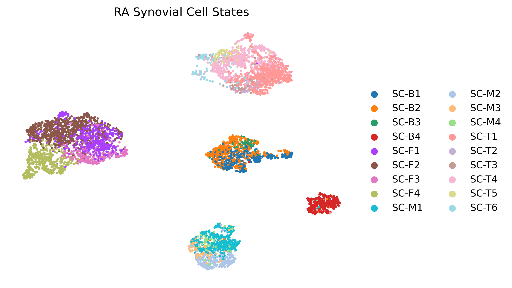
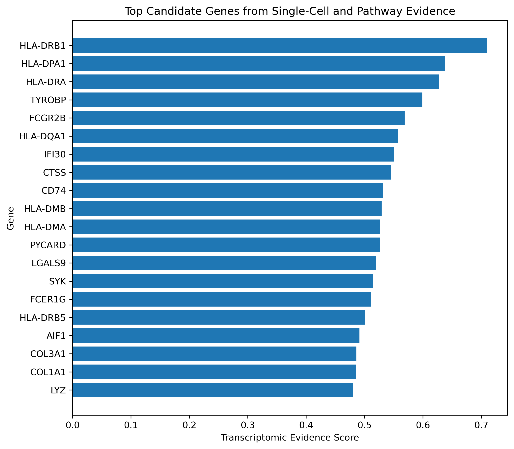
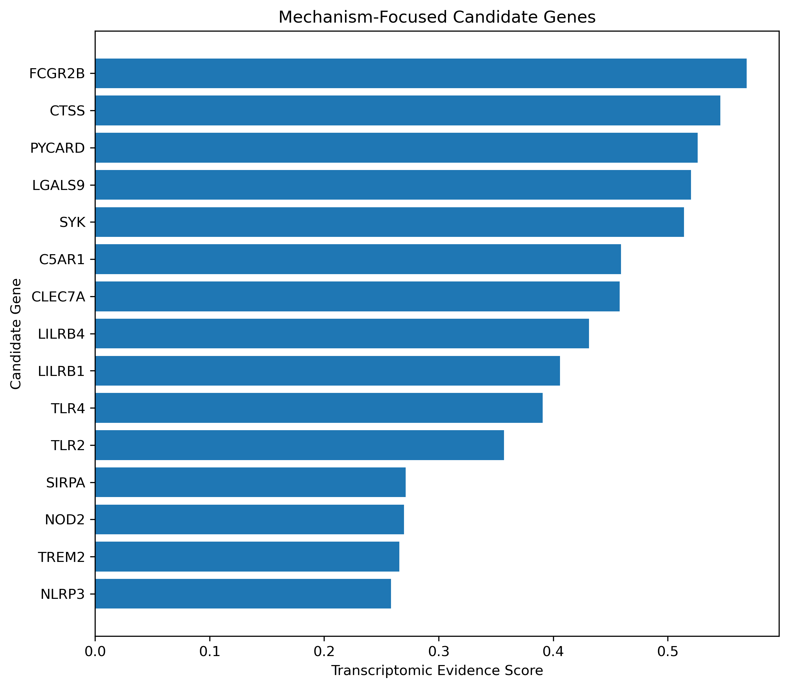
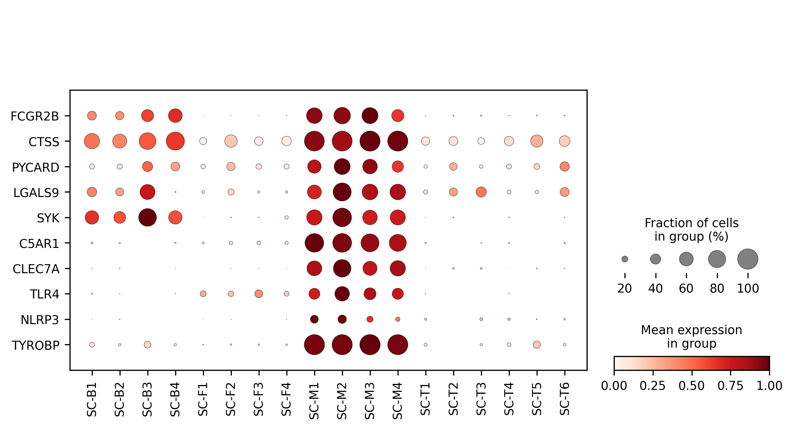
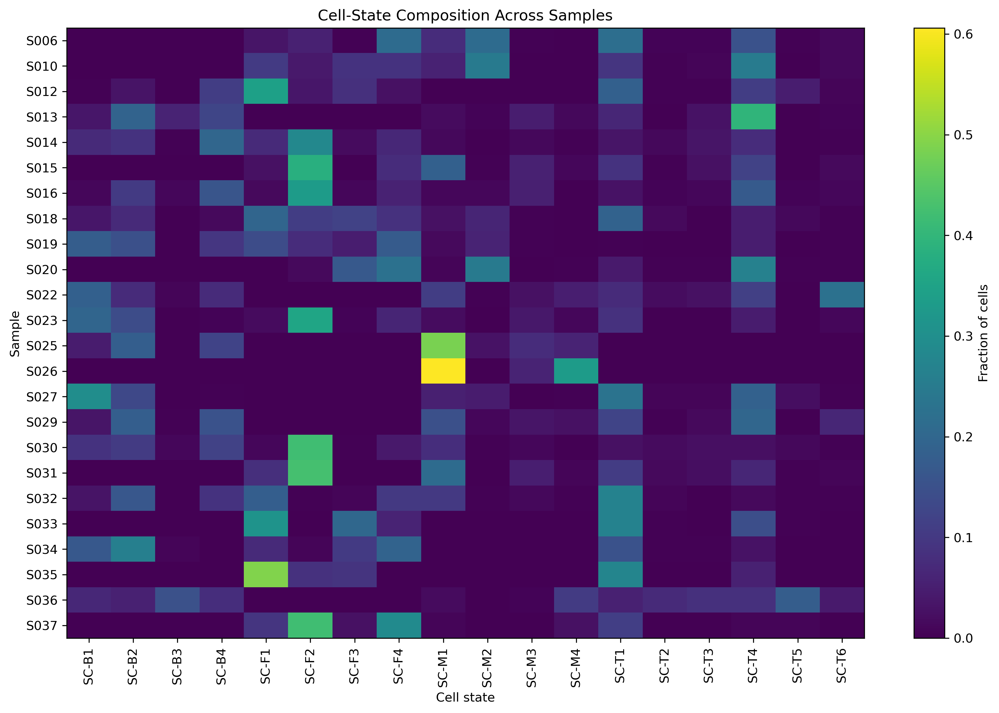
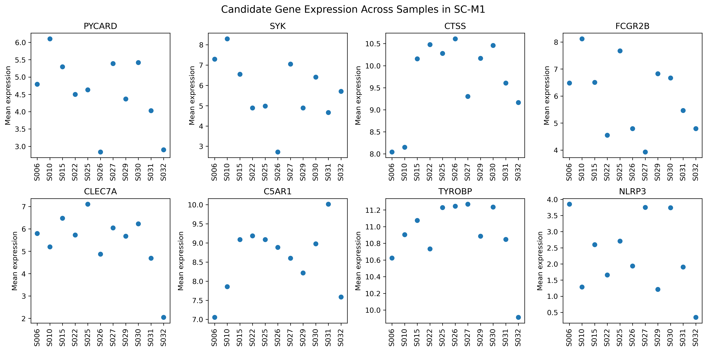
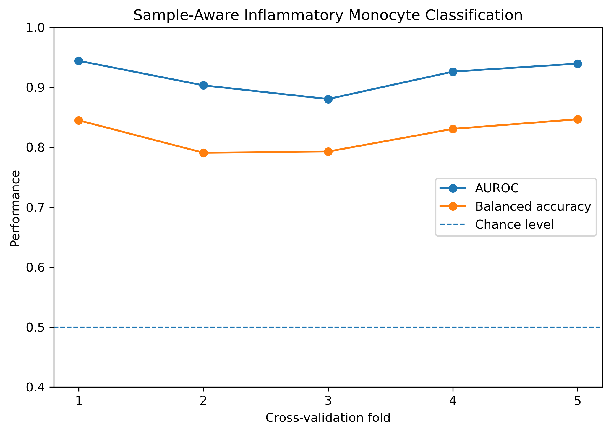
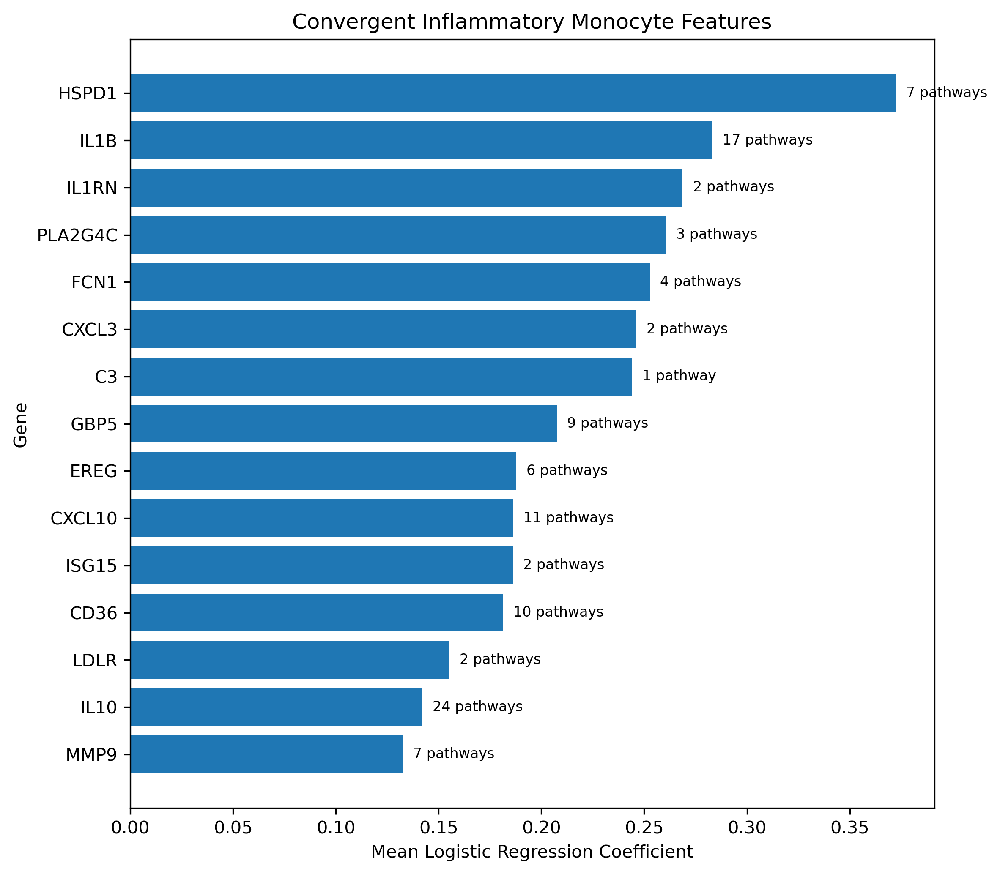

# Single-Cell and Machine-Learning Prioritization of Therapeutic Targets in Rheumatoid Arthritis

## Overview

This project integrates **single-cell transcriptomics, pathway analysis, therapeutic target prioritization, and interpretable machine learning** to investigate inflammatory mechanisms in rheumatoid arthritis (RA) synovial tissue.

Using publicly available single-cell RNA-seq data from the AMP Rheumatoid Arthritis Phase 1 study, the analysis combines two complementary computational workflows:

1. **Single-cell target discovery** — identifies disease-relevant transcriptional programs and prioritizes candidate genes using differential expression, ranked gene set enrichment analysis (GSEA), leading-edge analysis, and cross-cell-state evidence integration.
2. **Interpretable machine learning** — tests whether gene-expression profiles can distinguish inflammatory monocyte states across held-out sequencing samples and identifies stable predictive features.

The two analyses are integrated to identify genes supported by both **pathway-level biological evidence** and **predictive inflammatory-state evidence**.

---

## Key Results

### Single-Cell Target Discovery

- **5,265 cells**
- **29,165 genes**
- **18 published synovial cell states**
- **24 sequencing samples**
- **2,000 highly variable genes**
- **132 significantly positively enriched GO Biological Process pathways**
- **1,018 cell-state–gene candidate pairs**
- **673 unique candidate genes**

The strongest unbiased transcriptomic signal converged on **MHC class II antigen presentation and myeloid immune biology**.

Eight genes remained among the top 20 candidates across alternative evidence-weighting schemes:

**CTSS, FCER1G, HLA-DPA1, HLA-DQA1, HLA-DRA, HLA-DRB1, IFI30, and TYROBP**

Four genes remained among the top 20 after removal of any individual evidence component:

**HLA-DPA1, HLA-DRA, HLA-DRB1, and TYROBP**

### Interpretable Machine Learning

A regularized logistic regression classifier was trained to distinguish inflammatory monocyte states (**SC-M1 + SC-M4**) from other monocyte states (**SC-M2 + SC-M3**).

The analysis included:

- **750 monocytes**
- **20 sequencing samples**
- **5-fold stratified group cross-validation**
- sample-level separation between training and validation sets
- fold-specific highly variable gene selection to reduce information leakage

Model performance:

- **Mean AUROC: 0.919 ± 0.027**
- **Mean balanced accuracy: 0.821 ± 0.028**

### Convergent Computational Evidence

Stable inflammatory-state ML features were compared with SC-M1/SC-M4 genes identified independently through ranked GSEA and leading-edge analysis.

This identified **21 convergent inflammatory-monocyte genes**, including:

**IL1B, IL1RN, FCN1, CXCL3, GBP5, CXCL10, ISG15, CD36, IL10, MMP9, and RSAD2**

These genes receive support from two complementary computational perspectives:

- participation in disease-relevant biological pathways
- predictive association with inflammatory monocyte states across held-out samples

Because both analyses use the same underlying dataset, this overlap is interpreted as **convergent computational evidence rather than independent biological validation**.

---

## Analysis Workflow

```text
AMP RA single-cell RNA-seq
            |
            v
5,265 cells x 29,165 genes
            |
            +-------------------------------+
            |                               |
            v                               v
Single-cell target discovery       Interpretable ML
            |                               |
HVG -> PCA -> neighbor graph        Monocyte subset
            |                      SC-M1/M2/M3/M4
            v                               |
Differential expression                     v
            |                    Inflammatory vs other
            v                               |
Ranked GSEA                                  v
            |                    Sample-aware 5-fold CV
            v                               |
Leading-edge genes                           v
            |                    Logistic regression
            v                               |
Cross-cell-state integration                 v
            |                    Stable predictive genes
            v                               |
Transcriptomic evidence score                |
            |                               |
            +---------------+---------------+
                            |
                            v
                 Convergent evidence
```

---

## Single-Cell Analysis

The processed expression matrix was analyzed using Scanpy.

Because the source matrix had already undergone quality control and was provided as `log2(CPM + 1)`, raw-count normalization and cell-level QC were not repeated.

The workflow included:

- highly variable gene selection
- principal component analysis
- nearest-neighbor graph construction
- UMAP visualization
- published cell-state annotation integration
- Wilcoxon differential-expression analysis
- ranked GSEA against GO Biological Process gene sets
- leading-edge gene extraction
- cross-cell-state candidate integration
- transcriptomic evidence scoring
- ranking sensitivity analysis
- sample-level robustness analysis

### Cell-State Landscape



Major transcriptional compartments contained cells from multiple sequencing samples, providing a visual check against strong single-sample domination of the embedding.

---

## Therapeutic Target Prioritization

Candidate genes were prioritized using five complementary transcriptomic evidence components:

- pathway recurrence
- cross-cell-state recurrence
- expression effect size
- differential-expression strength
- statistical evidence

Each component was normalized before integration into an exploratory **Transcriptomic Evidence Score**.



The score is intended to prioritize transcriptomic hypotheses and **does not represent predicted therapeutic efficacy**.

A separate mechanism-focused shortlist was used to highlight immune-signaling genes for downstream therapeutic interpretation.



---

## Candidate Expression Across Cell States

Candidate expression was evaluated across the 18 published cell states to distinguish broadly expressed immune programs from more cell-state-specific signals.



---

## Sample-Level Robustness

Cell-state composition varied substantially across sequencing samples.



Candidate expression within SC-M1 was also examined across samples to assess whether selected signals were dominated by individual sequencing samples.



These analyses are interpreted at the **sample level**, because a complete sample-to-patient clinical crosswalk was not available for this reanalysis.

---

## Machine Learning

The second analysis asks a complementary question:

> Can transcriptomic features distinguish inflammatory monocyte states from other monocyte states across unseen sequencing samples?

Inflammatory monocytes were defined as **SC-M1 and SC-M4**, while **SC-M2 and SC-M3** formed the comparison class.

To reduce information leakage:

- sequencing sample was used as the cross-validation grouping variable
- cells from the same sample were never shared between training and validation folds
- highly variable genes were selected independently within each training fold
- feature scaling was fit using training data only

### Cross-Validation Performance



The classifier achieved a mean AUROC of **0.919 ± 0.027** and mean balanced accuracy of **0.821 ± 0.028** across five held-out-sample folds.

### Convergent Inflammatory Features

Logistic-regression coefficients were aggregated across folds to identify stable predictive features and compared with pathway-derived monocyte candidates from the first analysis.



This analysis identified **21 genes** with both inflammatory-state predictive evidence and SC-M1/SC-M4 pathway evidence.

Predictive features should not be interpreted directly as therapeutic targets: a gene may discriminate a cellular state without being causal, druggable, safe, or therapeutically beneficial.

---

## Repository Structure

```text
single_cell_ra/
|
|-- README.md
|-- environment.yml
|-- .gitignore
|
|-- data/
|   `-- README.md
|
|-- notebooks/
|   |-- 01_ra_single_cell_target_discovery.ipynb
|   `-- 02_inflammatory_monocyte_ml.ipynb
|
|-- figures/
|   |-- 01_umap_cell_states.png
|   |-- 04_transcriptomic_candidate_ranking.png
|   |-- 05_mechanism_focused_candidates.png
|   |-- 06_candidate_expression_dotplot.png
|   |-- 07_sample_cell_state_composition.png
|   |-- 09_scm1_candidate_sample_reproducibility.png
|   |-- 10_ml_cross_validation_performance.png
|   `-- 11_ml_convergent_monocyte_features.png
|
`-- results/
    |-- cluster_markers.csv
    |-- significant_gsea_pathways.csv
    |-- gene_level_target_prioritization.csv
    |-- mechanism_focused_candidate_targets.csv
    |-- target_ranking_robustness.csv
    |-- sample_candidate_expression.csv
    |-- ml_cross_validation_performance.csv
    |-- ml_gene_coefficients.csv
    |-- ml_stable_features.csv
    `-- ml_convergent_monocyte_genes.csv
```

Large source expression files and processed AnnData objects are excluded from version control.

---

## Reproducibility

Create the Conda environment:

```bash
conda env create -f environment.yml
conda activate single-cell-ra
```

Place the required source files in `data/` as described in [`data/README.md`](data/README.md).

Run the notebooks in order:

1. `notebooks/01_ra_single_cell_target_discovery.ipynb`
2. `notebooks/02_inflammatory_monocyte_ml.ipynb`

Both notebooks were tested using a fresh kernel and executed successfully from beginning to end.

---

## Limitations

- The project reanalyzes a processed `log2(CPM + 1)` expression matrix rather than raw sequencing counts.
- Published cell-state annotations are used rather than performing de novo biological annotation.
- Individual cells are not independent biological replicates; sample-aware analyses were used where possible.
- A complete sample-to-patient clinical crosswalk was not available in the analyzed files.
- The Transcriptomic Evidence Score is an exploratory prioritization framework rather than a validated therapeutic prediction model.
- The ML classifier predicts inflammatory monocyte state, **not therapeutic efficacy**.
- ML and pathway analyses use the same underlying dataset; their overlap is therefore convergent computational evidence rather than independent validation.
- Candidate therapeutic hypotheses require independent genetic, pharmacologic, safety, and clinical validation.

---

## Tools

- Python
- Scanpy
- AnnData
- pandas
- NumPy
- SciPy
- scikit-learn
- GSEApy
- matplotlib

---

## Data and Original Study

This project uses publicly available data from the AMP Rheumatoid Arthritis Phase 1 study.

### Publication

Zhang F, Wei K, Slowikowski K, et al. *Defining inflammatory cell states in rheumatoid arthritis joint synovial tissues by integrating single-cell transcriptomics and mass cytometry.* Nature Immunology. 2019;20:928–942.

DOI: `10.1038/s41590-019-0378-1`

### Original Analysis Code

https://github.com/immunogenomics/amp_phase1_ra

### AMP RA Phase I Resource

https://immunogenomics.io/ampra/

This repository contains an independent Python/Scanpy reanalysis focused on pathway-level target prioritization, robustness analysis, and sample-aware interpretable machine learning.